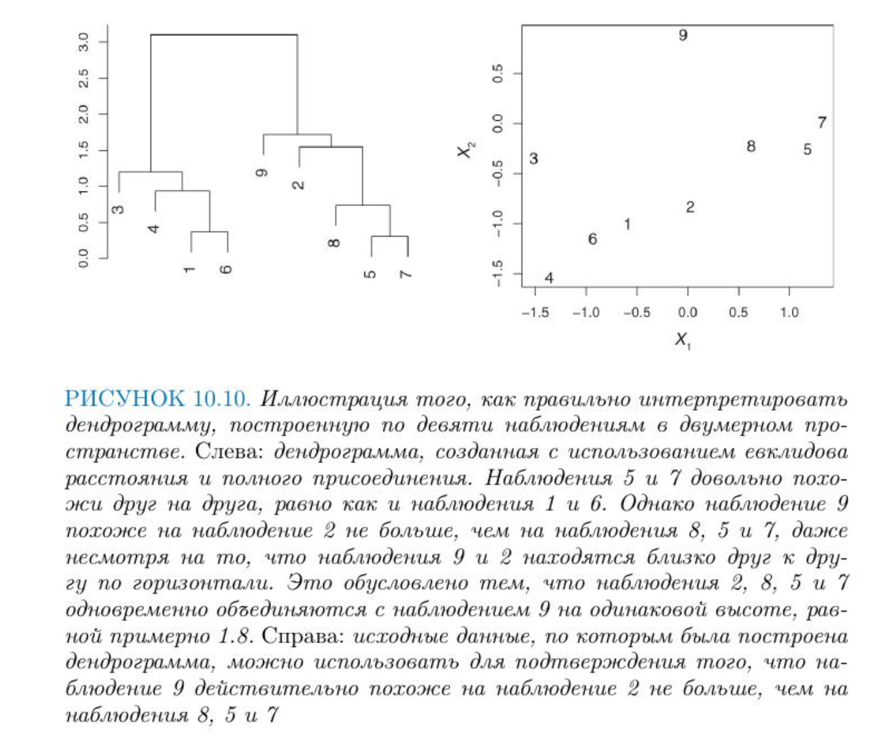
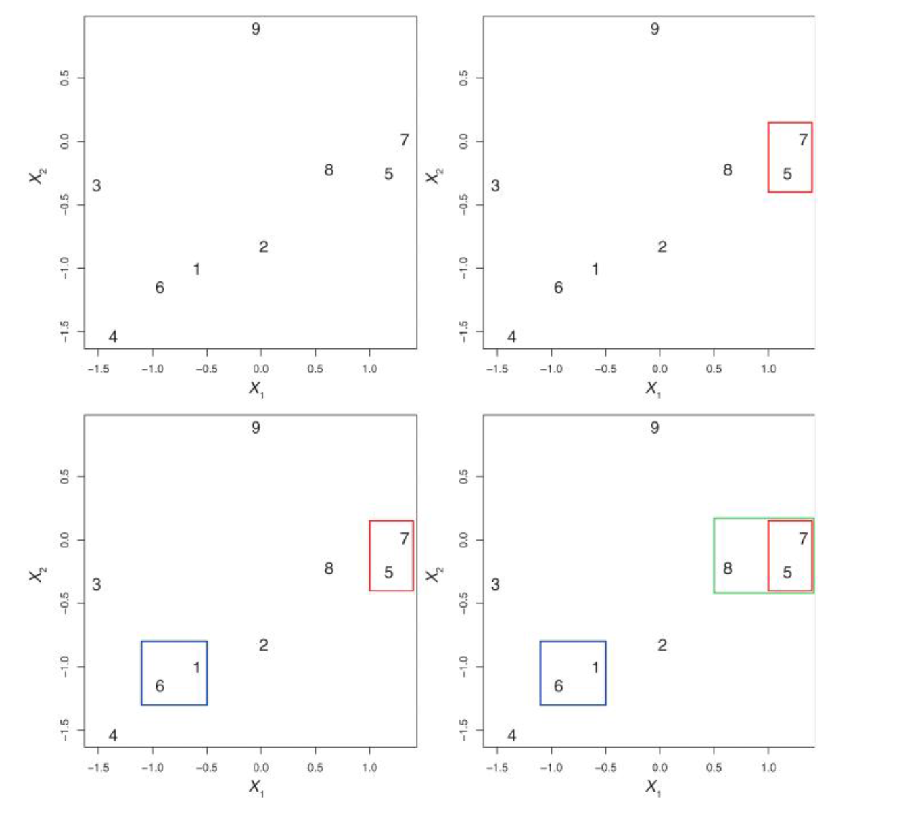
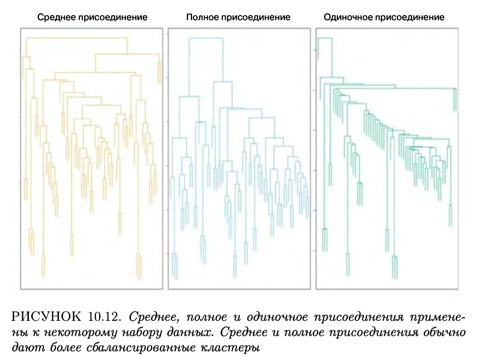
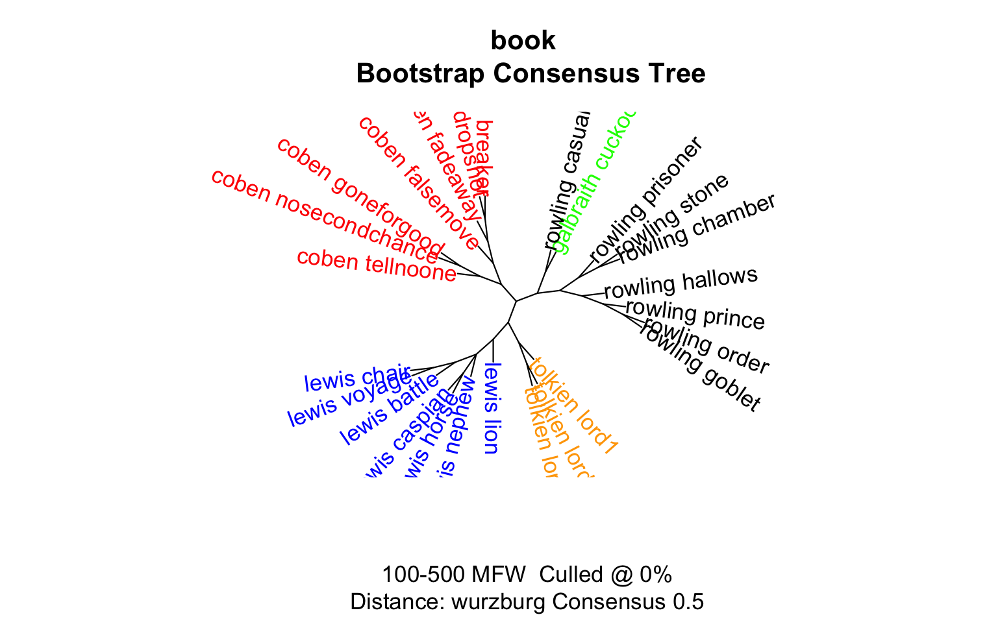
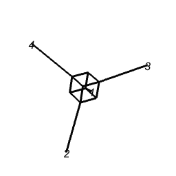
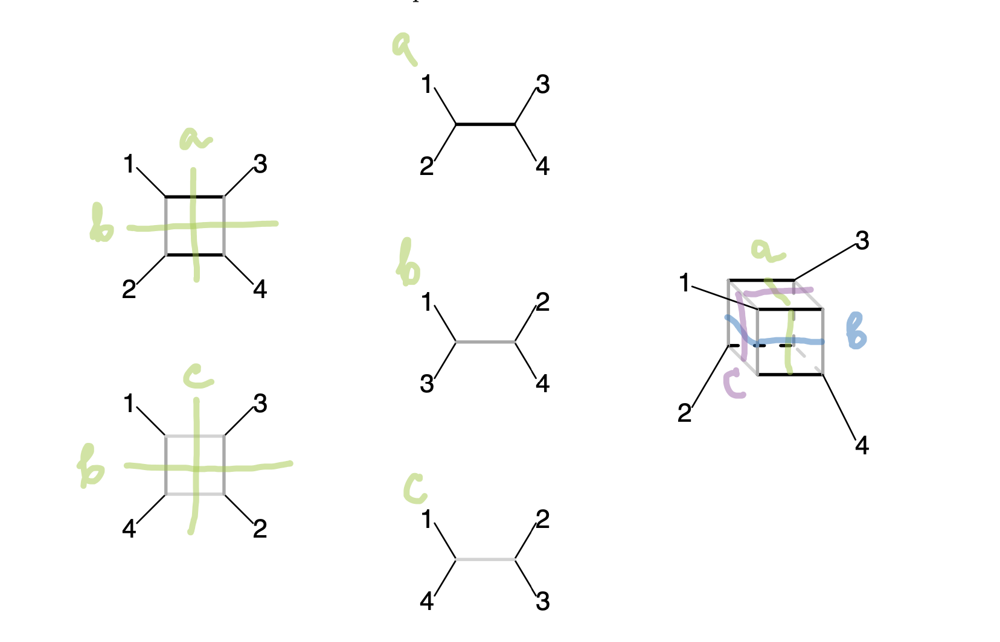
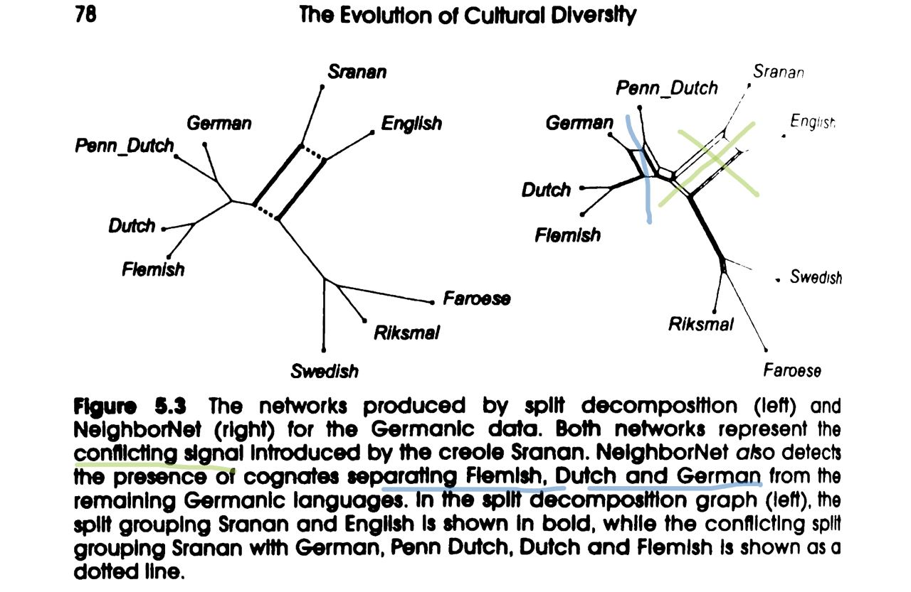

# Консенсусные деревья и сети

```{r message=FALSE, warning=FALSE}
library(dendextend)
library(stylo)
library(ape)
library(tidyverse)
library(ggsci) # не обязательно
library(phangorn)
library(TreeTools)
library(rgl) # не обязательно
library(igraph)
library(ggraph)
library(philentropy)
```


## Иерархическая кластеризация 

Одним из недостатков кластеризации по методу k-средних является то, что она требует предварительно указать число кластеров. Этого недостатка лишена иерархическая кластеризация. Если такая кластеризация происходит "снизу вверх", она называется _агломеративной_. При этом построение дендрограммы начинается с "листьев" и продолжается вплоть до самого "ствола".

 

При интерпретации дерева надо иметь в виду, что существует $2^{n-1}$ способов упорядочения ветвей дендрограммы, где n -- это число листьев. В каждой из точек слияния можно поменять местами наблюдения, не изменяя смысла дендрограммы. Поэтому выводы  о сходстве двух наблюдений нельзя делать на основе из близости по горизонтальной оси. См. рис. из книги [@хасти2017, 423)]. На рисунке видно, что наблюдение 9 похоже на наблюдение 2 не больше, чем оно похоже на наблюдения 8, 5 и 7. Выводы делаются, исходя из положения на вертикальной оси той точки, где происходит слияние наблюдений. 

Количество кластеров определяется высотой, на которой мы разрезаем дендрограмму. Из этого следует, что одну и ту же дендрограмму можно использовать для получения разного числа кластеров.

### Алгоритм кластеризации

1. Вычислить меру различия для всех пар наблюдений. На первом шаге все наблюдения рассматриваются как отдельный кластер. 

2. Найти пару наиболее похожих кластеров и объединить их. Различие между кластерами соответствует высоте, на которой происходит их слияние в дендрограмме. 

3. Повторить шаги 1-2, пока не останется 1 кластер.



### Тип присоединения

Вид дерева будет зависеть от типа присоединения. На рисунке ниже представлено три способа: полное, одиночное, среднее. 


Обычно предпочитают среднее и полное, т.к. они приводят к более сбалансированным дендрограммам. 



Для функции `hclust()` в R по умолчанию выставлено значение аргумента `method = "complete"`.

###  Кластеризация в R

Функция `dist()` по умолчанию считает евклидово расстояние. 

```{r}
data("galbraith")

galbraith <- as.data.frame.matrix(galbraith) |> 
  scale()

hc_complete <- hclust(dist(galbraith), method = "complete")
plot(hc_complete)
```


Для вычисления расстояния между текстами лучше подойдет не евклидово, а косинусное расстояние на нормализованных данных. В базовой `dist()` его нет, поэтому воспользуемся пакетом `philentropy`.

```{r}
dist_mx <- galbraith  |> 
  philentropy::distance(method = "cosine", use.row.names = TRUE) 
```

Преобразуем меру сходства в меру расстояния и передадим на кластеризацию. 

```{r}
dist_mx <- as.dist(1 - dist_mx)
hc <- hclust(dist_mx)

plot(hc)
```

Для получения меток кластеров, возникающих в результате рассечения дендрограммы на той или иной высоте, можно воспользоваться функцией `cutree()`.

```{r}
cutree(hc, 5)
```

Этим меткам можно назначить свой цвет.

```{r message=FALSE}
hcd <- as.dendrogram(hc)

par(mar=c(2,2,2,7))

hcd |> 
  set("branches_k_color", k = 5) |> 
  set("labels_col", k=5) |> 
  plot(horiz = TRUE)

abline(v=0.8, col="pink4",lty=2)
```

 
## Танглграммы

Важно помнить, что результат кластеризации зависит [от нескольких параметров](https://academic.oup.com/dsh/article/32/1/50/2957386):

- число предикторов (например, наиболее частотных слов для разных произведений);
- расстояние, которое используется для попарных сравнений (евклидово, косинусное, др.)
- метод связи (метод полной связи, метод средней связи, метод Уорда и др.);

Иногда добавление или удаление буквально одного слова меняет структуру дерева.

Поэтому бывает необходимо сравнить разные деревья. Один из способов это сделать визуально -- построить tanglegram, например, при помощи пакета `dendextend`. 

```{r message=FALSE}
d1 <- as.dendrogram(hclust(dist_mx, method ="average"))  |>  
  set("labels_col", value = c("skyblue", "orange", "grey40"), k=3)  |> 
  set("branches_k_color", value = c("skyblue", "orange", "grey40"), k = 3)

d2 <- as.dendrogram(hclust(dist_mx, method ="ward.D2")) |> 
  set("labels_col", value = c("skyblue", "orange", "grey40"), k=3)  |> 
  set("branches_k_color", value = c("skyblue", "orange", "grey40"), k = 3)

dlist <- dendlist(d1, d2)

par(family = "Arial Bold")

tanglegram(dlist, common_subtrees_color_lines = FALSE, 
           highlight_distinct_edges  = TRUE, 
           highlight_branches_lwd=FALSE, 
           margin_inner=10, 
           lwd=2, 
           axes=FALSE, 
           main_left = "Cредняя", 
           main_right = "Уорд", 
           lab.cex = 1.3)
```

На картинке видно, что книги группируются немного по-разному в зависимости от метода связи, хотя для кластеризации использовалась одна и та же матрица расстояний.

## Консенсусные деревья в `stylo`

Консенсусное дерево позволяет "обобщить" произвольное число дендрограмм. В `stylo` за консенсусные деревья отвечает метод  `BCT` (Bootstrap Consensus Tree), к которому можно обратиться через GUI (но здесь мы показываем решение без него).

```{r eval=FALSE}
bct_result <- stylo(gui = FALSE, 
                    frequencies = galbraith,
                    analysis.type = "BCT",
                    mfw.min = 100,
                    mfw.max = 500,
                    mfw.incr = 100,
                    distance.measure = "wurzburg",
                    write.png.file = FALSE,
                    consensus.strength = 0.5,
                    plot.custom.width = 8, 
                    plot.custom.height = 8
                    )
```



Работать через GUI удобно, но есть нюансы. Во-первых, не получится кастомизировать внешний вид дерева, а, во-вторых, в Stylo реализована достаточно специфическая процедура бутстрепа (повторных выборок). 

Вот что [пишут](https://journal.r-project.org/archive/2016/RJ-2016-007/RJ-2016-007.pdf) разработчики:

> Under the FEATURES tab, users can define the minutes of the MFW division and sampling procedure, using the increment, the minimum and maximum parameters. For minimum = 100, maximum = 3000, and increment = 50, stylo will run subsequent analyses for the following frequency bands: 100 MFW, 50–150 MFW, 100–200 MFW, ..., 2900–2950 MFW, 2950–3000 MFW.

Для консенсуса нужно много деревьев, и Stylo будет строить эти деревья в заданном интервале. Это значит, что последние деревья будут построены уже не на основе самой частотной лексики, т.е. скорее всего на них отразится тематика текстов, входящих в корпус. 

В некоторых случаях это работает неплохо, но, возможно, у вас есть другие идеи для консенсуса. Разные расстояния. Разные методы кластеризации. Случайные выборки из первых двух сотен слов или еще что-то. Тогда придется самим строить сразу множество деревьев.

## Целый лес c `purrr`

Если изучить изнанку функции `stylo()`, которая вызывает GUI в одноименном пакете, то можно заметить, что за консенсусное дерево там отвечает пакет для работы с филогенетическими данными под названием `{ape}` 🦍

Что делает машина, когда вы заказываете у нее консенсусное дерево? Принимает на входе матрицу с `1 … n` столбцами, в которых хранится частотность для слов. Потом отбирает первые сколько-то слов (скажем, сотню или сколько скажете), считает расстояние, строит на основе матрицы расстояний дерево, складывает его в корзинку. Потом берет следующую сотню слов, считает расстояние, строит дерево, складывает в корзинку… Ну вы поняли. Получается целый лес. 

Звучит как итерация, а такие задачи в R решаются при помощи цикла `for` или пакета `purrr`. Функции `map()` из пакета `purrr` надо вручить другую функцию -- у нас это будет пользовательская  `get_tree()`.  Она берет случайные 100 столбцов в таблице с частотностями `galbraith` из пакета `Stylо`, считает расстояние городских кварталов между документами и строит дерево. 

:::{.callout-tip icon=false}
Как называется метод, использующий расстояние городских кварталов на стандартизированных показателях частотности? Ответ найдете в предыдущем уроке.
:::

```{r message=FALSE}

get_tree <- function(df) {
  X <- df[ , sample(3000, replace = FALSE, size = 100)]
  # стандартизация
  distmx <- dist(X, method = "manhattan")
  tr <- as.phylo(hclust(distmx))
  tr
}
```

Запускаем функцию несколько раз при помощи `map()`, получаем список деревьев. Если хочется на них посмотреть по отдельности, то функцией `walk()` печатаем сразу несколько деревьев одной строчкой кода 🧙🪄

```{r message=FALSE}
set.seed(123)

trees_result <- map(1:100, ~get_tree(galbraith))

# отдельные деревья
par(mfrow = c(2, 2), mar = c(1,1,1,1))
walk(trees_result[1:4], plot)
```

:::{.callout-tip icon=false}
Подумайте, как можно модифицировать функцию, чтобы посчитать косинусное расстояние? Ответ найдете чуть ниже.
:::

Так можно построить и 100, и 1000 деревьев. Но сравнивать их вручную мы не будем, а вместо этого посчитаем консенсус. Но сначала разберемся, что это такое.

## `plot.phylo()`: простой пример

Допустим, у нас есть три дерева. Создадим их с использованием формата Ньюика, т.е. просто-напросто комбинации скобок и запятых. 


```{r}
tr1 <- read.tree(text = "((1,2),(3,4));")
tr2 <- read.tree(text = "((1,3),(2,4));")
tr3 <- read.tree(text = "((1,2),(3,4));")


par(mfrow = c(1, 3), mar = c(5,1,5,1), cex = 1)
walk(list(tr1, tr2, tr3), plot.phylo, tip.color = "firebrick", font = 2, edge.width = 1.5)
```

Кластеры 1-2, 3-4 встречаются в двух деревьях, остальные лишь в одном. Задача — найти наиболее устойчивые кластеры методом [простого большинства](https://www.webpages.uidaho.edu/~jacks/545.Lecture13.pdf). Для этого считаем консенсус, причем аргумент `p` указывает, что кластер должен быть представлен не менее, чем в половине деревьев. Также уточняем, что наши деревья укоренены.

```{r}
cons <- consensus(list(tr1, tr2, tr3), p = 0.5, rooted = TRUE)
```

Значение p не может быть меньше 0.5, потому что конфликтующие сплиты не могут быть представлены вместе в одном дереве.

Теперь изобразим консенсус в виде дерева; дополнительно для узлов укажем силу консенсуса (2/3 = 0.67). Обратите внимание, как менять форму и цвет меток.

```{r}
par(mfrow = c(1,1), mar = c(5,5,5,5))
plot.phylo(cons, tip.color = "firebrick", 
           edge.width = 1.5, font = 2)
nodelabels(round(cons$node.label[3],2), 7, 
           frame = "c", cex = 0.7)
nodelabels(round(cons$node.label[2],2), 6, 
           bg = "darkolivegreen", col = "white")
```

Это очень простое консенсусное дерево, построенное по методу простого большинства. 

## `plot.phylo()`: galbraith

Теперь попробуем сделать такое же дерево для текcтовых данных. Для выбора палитры обратимся к пакету `{ggsci}` ([виньетка](https://cran.r-project.org/web/packages/ggsci/vignettes/ggsci.html#NEJM)).

```{r message=FALSE, fig.height=9}
# добавим красоты 
cols <- pal_igv()(5)

cons <- consensus(trees_result, p = 0.5, rooted = FALSE)

# назначаем авторам цвета
cols <- tibble(author = str_remove(cons$tip.label, "_.+")) |> 
  mutate(color = case_when(author == "coben"  ~ cols[1],
                           author == "galbraith" ~ cols[2],
                           author == "lewis"  ~ cols[3],
                           author == "rowling" ~ cols[4],
                           author == "tolkien"  ~ cols[5]))
 
# строим дерево
par(mar = c(0,0,0,0))
plot.phylo(cons, 
           type = "fan", 
           use.edge.length = TRUE,
           edge.width = 1.5, 
           node.color = "grey30",
           font = 2, 
           no.margin = TRUE, 
           label.offset = 0.1,
           direction = "rightwards", 
           plot = TRUE, 
           lab4ut = "a",
           node.depth = 1, 
           tip.color = cols$color,
           cex = 1.2)

# подписываем узлы
nodelabels(text=sprintf("%.2f", cons$node.label),
           node=1:cons$Nnode+Ntip(cons),
           frame="circle",
           bg = "white",
           cex = 1, 
           )

```


:::{.callout-tip icon=false}
О чем вам говорит это дерево? Поменяйте тип дерева с `fan` на что-то иное.
:::

## `consensusNet()`: простой пример

У консенсусного дерева есть одно очевидное ограничение: оно плохо передает конфликтующие сигналы. Допустим, у нас есть три неукоренённых дерева. 

```{r fig.align='center', fig.height=4}
tr1 <- read.tree(text = "((1,2),(3,4));")
tr2 <- read.tree(text = "((1,3),(2,4));")
tr3 <- read.tree(text = "((1,4),(2,3));")

# Настраиваем область графика
par(mfrow = c(1, 3), 
    mar = c(2, 2, 2, 2), 
    oma = c(1, 1, 1, 1))

# Функция для рисования с увеличенными границами
plot_tree_with_space <- function(tree) {
  # Используем в вашем случае больший отступ
  plot.phylo(tree, 
             tip.color = "firebrick",  
             font = 2,
             edge.width = 1.5,
             type = "unrooted",
             label.offset = 0.5,
             cex = 1,
             # Добавляем параметр, дающий больше места
             x.lim = c(-2, 2),  # Увеличенные границы по X
             y.lim = c(-2, 2))  # Увеличенные границы по Y
}

# Применяем функцию к каждому дереву
invisible(lapply(list(tr1, tr2, tr3), plot_tree_with_space))
```


Консенсусное дерево в таком случае никак не поможет: оно не допускает значений $p < 0.5$. Проверьте сами: код ниже вернет садовые вилы 🔱

```{r}
par(mfrow = c(1,1))
cons <- consensus(list(tr1, tr2, tr3), p = 0.5, rooted = F)
plot.phylo(cons, tip.color = "firebrick", 
           font =2, label.offset = 0.1)

nodelabels(text=as.character(cons$node.label),
           node=1:cons$Nnode+Ntip(cons),
           frame="circle",
           bg = "darkolivegreen",
           col = "white"
           )
```

В таких случаях на помощь приходит консенсусная сеть. Построим сеть с использованием пакета `{phangorn}`. На входе отдаем объект класса `multiPhylo`, это по сути просто три дерева в одном "букете".

```{r message=FALSE}
mph <- as.multiPhylo(list(tr1, tr2, tr3))

cons.nw <- consensusNet(mph, prob = 0.3, rooted = FALSE)
class(cons.nw)
```

Объект `cons.nw` относится к классу `networx`. Его можно изобразить как в двух, так и в трех измерениях. Вот 2D.

```{r}
set.seed(16092024)
par(mar = c(0,0,0,0))
plot(cons.nw, type = "2D", 
     tip.color = "firebrick", font = 2)
```

А вот 3D. 

```{r eval=FALSE}
plot(cons.nw, "3D")
# create animated gif file 
movie3d(spin3d(axis=c(0,1,0), rpm=3), 
        duration=10, 
        dir = ".",  
        type = "gif")
```



Теперь попробуем понять, что это значит (иллюстрация и объяснение [отсюда](https://link.springer.com/book/10.1007/978-1-4614-1743-9)). 

 


Рассмотрим неукорененные деревья в середине: их внутренние ветви определяют расщепления (splits), а именно 12|34, 13|24 и 14|23, которые явно не могут наблюдаться в одном дереве и, следовательно, все они несовместимы. Сеть в левом верхнем углу представляет одновременно два первых дерева с прямоугольником, символизирующим две внутренние ветви. Чтобы представить все три расщепления, нам нужен куб, как показано справа. 


## `consensusNet()`: galbraith

Итак, у нас есть сто деревьев для данных galbraith.

```{r message=FALSE}
# вычисляем консенсус
mph <- as.multiPhylo(trees_result)
cons.nw <- consensusNet(mph, prob = 0.3, rooted = FALSE)
```

Придется немного поколдовать, чтобы раскрасить сеть. 

```{r}
cons.nw$author <- str_remove_all(cons.nw$tip.label, "_.+")

col_tbl <- tibble(label = unique(cons.nw$author),
                  col = pal_d3()(5))

color_group <- tibble(label = cons.nw$author) |> 
  left_join(col_tbl)
  
cons.nw$col <- color_group$col
```

```{r fig.height=9}
set.seed(04032024)
par(mar = c(0,0,0,0), oma = c(0,0,0,0), cex = 1.2)

plot(cons.nw, type = "2D", 
     direction = "axial",
     use.edge.length = FALSE,
     font = 2,
     tip.color = cons.nw$col,
     edge.color = "grey30",
     edge.width = 1.2)
```

Таким образом, `consensusNet()` строит консенсусную сеть на основе набора деревьев: это позволяет визуализировать степень поддержки различных связей, найденных в наборе деревьев. Подход полезен для выявления областей неопределенности в филогенетических отношениях, когда несколько разных деревьев одинаково хорошо соответствуют данным.

## `boot.phylo()`: galbraith

Выше мы получили объект `trees_result` путем применения пользовательской функции `get_tree()` к данным. В пакете `{phangorn}`, однако, есть готовое решение для бутстрепа. Воспользуемся им и сравним результат. Заодно поменяем расстояние на косинусное и изменим алгоритм кластеризации на NJ.

```{r}
# функция для вычисления расстояния
dtm_to_dist <- function(data){
  dist_mx <- data |>
    philentropy::distance(method = "cosine", 
                          use.row.names = TRUE, 
                          mute.message = TRUE) |>  
    as.dist()
  
  return(1 - dist_mx)
} 

# матрица расстояния (все 3000 признаков)
dist_mx <- dtm_to_dist(galbraith)

# кластеризация NJ
nj <- nj(dist_mx)
```

Вот так выглядит одно дерево. Пока оставим его без оформления.

```{r}
nj |> 
  plot(type = "unrooted",
       lab4ut = "axial")
```

Теперь применяем функцию для бутстрепа. На входе она требует одно дерево, функцию для его получения, а также исходный датасет для бутстрепа. Значение аргумента `trees` выставляем на `TRUE`: это значит, что все построенные деревья будут сохраняться.  

```{r}
# bootstrap
dtm_to_nj <- function(xx) nj(dtm_to_dist(xx)) 

tree <- dtm_to_nj(galbraith)

bs <- boot.phylo(tree, galbraith, dtm_to_nj, 
                 # сто итераций
                 B = 100, 
                 # признаки берутся блоками по 1
                 block = 1,
                 rooted = FALSE, 
                 trees = TRUE)
```

После этого строим консенсусную сеть (или консенсусное дерево, см. выше).

```{r}
# вычисляем консенсус
cons.nw2 <- consensusNet(bs$trees, prob = 0.3, rooted = FALSE)
```

Теперь попробуем снова визуализировать наше консенсусное дерево. 

```{r fig.height=9}
set.seed(05032024)
par(mar = c(0,0,0,0), oma = c(0,0,0,0), cex = 1.2)

plot(cons.nw2, type = "2D", 
     direction = "axial",
     use.edge.length = FALSE,
     font = 2,
     # берем из предыдущей сети :)
     tip.color = cons.nw$col,
     edge.color = "grey30",
     edge.width = 1.2)
```

:::{.callout-tip icon=false}
Что произойдет с сетью, если изменить силу консенсуса? Почему? Самостоятельно постройте консенсусное дерево на основе бутстрепа.
:::


## `neighborNet()`: простой пример 

Еще один алгоритм для визуализации неоднозначных филогенетических отношений в R назвается [neighborNet](https://academic.oup.com/mbe/article/21/2/255/1187993). Он подходит для тех случаев, когда мы подозреваем нарушения в древовидной структуре (в генетике это может быть горизонтальный перенос генов, а в литературе -- например, отношения подражания или т.п.). 

Ключевое различие по сравнению с `consensusNet()` заключается в том, что `neighborNet()` строит сеть непосредственно из данных, а не на основе набора деревьев. 

NeighborNet работает в два шага:

- Сначала строит круговую раскладку для таксонов таким образом, чтобы минимизировать расстояния между парами кластеров, каждый из которых включает в себя 1 или 2 таксона. 
- Потом считает веса для сплитов. На этом этапе некоторые ребра удаляются, а другие вытягиваются сообразно весам. Чем длиннее ребро, тем больше вес сплита. 

Рассмотрим это на простом примере. Представьте, что у нас есть следующая матрица расстояний. 

```{r}
mx <- matrix(data = c(0, 0.07, 0.12, 0.12, 0.07, 0, 0.13, 0.09, 0.12, 0.13, 0, 0.06, 0.12, 0.09, 0.06, 0), nrow = 4)
colnames(mx) <- c("a", "b", "c", "d")
rownames(mx) <- colnames(mx)
mx

D <- as.dist(mx)
D
```

От матрицы расстояний можно перейти к длине ребер. Для нашей простой матрицы длина горизонтальных ребер, например, считается по формуле: 

$1/2 (max(D[a,d]+D[b,c], D[a,c]+D[b,d])-D[a,b] – D[d,c])$

$1/2 (max(0.12+0.13, 0.12+0.09) – 0.07 – 0.06) = 0.06$


```{r}
nnet <- neighborNet(D)
par(mar = c(0,0,0,0))
plot(nnet, show.edge.label = T, 
     edge.label = nnet$edge.length, 
     edge.color = "grey", 
     col.edge.label = "navy")
```

Аналогичным образом считается длина вертикальных ребер. Формула сработает максимум для четырех таксонов, для более сложных структур понадобится метод наименьших квадратов. Все вычисления делает функция [neighborNet](https://rdrr.io/cran/phangorn/man/neighborNet.html) из пакета `phangorn`. 

Если аргументу `edge.label` оставить значение по умолчанию, то на картинке увидите номер сплита. 

```{r}
par(mar = c(0,0,0,0))
plot(nnet, show.edge.label = T, 
     edge.color = "grey", 
     col.edge.label = "firebrick")
```

У каждого сплита есть свой вес (рассчитанный методом наименьших квадратов). Его можно достать из объекта nnet. 

```{r}
w = attr(nnet$splits, "weights")
w
```
Это можно понять так: чтобы попасть из пунка b в пункт d, нужно сложить веса для сплитов 4, 5 и 1:

```{r}
w[4] + w[5] + w[1]
```
Это вернет нам 0.09. Сверяемся с матрицей расстояний — все верно! 

Сплит — это разбиение совокупности таксонов на два непустых множества. Посмотрим, какие сплиты возможны для 4 таксонов из нашего примера:  

```{r}
as.matrix(nnet$splits)
```

Первые четыре сплита довольно заурядны: мы просто откусываем по одному углу от нашего прямоугольника. Пятый сплит делит прямоугольник поперек, а шестой — вдоль. Дальше алгоритм для каждого сплита [считает](https://rdrr.io/cran/phangorn/src/R/neighborNet.R), какие пары таксонов оказались с разных сторон сплита. На основе  матрицы сплитов `А` и исходной матрицы расстояний `D` рассчитывается длина ребра таким образом, чтобы кратчайшие пути между таксонами были максимально приближены к исходной матрице расстояний. 

Как уже говорилось, для 4-х таксонов соответствие может быть полным. Это легко проверить, достав атрибут RSS (Residual Sum of Squares, остаточная сумма квадратов) из объекта nnet, который мы создали. 

```{r}
round(attr(nnet$splits, "RSS"), 3)
```

## `neighborNet()`: galbraith

Теперь применим алгоритм к реальным данным. 

```{r}
par(mar = c(0,0,0,0), cex = 0.8)
nnet <- neighborNet(dist_mx)

pal <- pal_d3()(5)


# назначаем авторам цвета
cols <- tibble(author = str_remove(nnet$tip.label, "_.+")) |> 
  mutate(color = case_when(author == "coben"  ~ pal[1],
                           author == "galbraith" ~ pal[2],
                           author == "lewis"  ~ pal[3],
                           author == "rowling" ~ pal[4],
                           author == "tolkien"  ~ pal[5]))
 

plot(nnet, 
     direction = "axial",
     edge.color = "grey30",
     use.edge.length = TRUE, # попробуйте FALSE
     edge.width = 1,
     tip.color = cols$color)
```


В статье  “Untangling Our Past: Languages, Trees, Splits and Networks” создатели алгоритма NeighborNet [объясняют](https://www.taylorfrancis.com/chapters/edit/10.4324/9781315418612-6/untangling-past-bryant-david-filimon-flavia-gray-russell), как правильно интерпретировать подобный граф на примере дерева германских языков.  



Конфликтующие сигналы передаются за счет “ретикулярной структуры” (квадратиков, проще говоря). Там, где конфликта нет, мы видим дерево.

Каждый сплит представлен несколькими параллельными линиями, и если эти параллели удалить, то граф распадется на два. Чем длиннее ребро, тем “весомее” сплит. 

На графе видно, что креольский язык сранан-тонго обладает сходством и с английским, и с нидерландским (граф можно разрезать по зеленым линиям двояко). 

Более слабый конфликтующий сигнал прослеживается между немецким, нидерландским и фламандским, с одной стороны, и пенсильванским немецким, с другой (синий разрез). 

Рассмотренные филогенетические методы (консенсусные сети, консенсусные деревья и neighborNet) ничего не говорят о происхождении одного текста от другого. Филограмма, полученная дистанционными методами, не отражает эволюционный процесс, а показывает [степень дивергенции таксонов](http://herbarium.tsu.ru/presentation/lection_5.pdf).

Это значит, что модель NeighborNet не делает никаких допущений о происхождении, однако в каком-то смысле она вполне способна показывать то, что называют «конфликтующими сигналами». В биологии это рекомбинация, гибридизация и т.п., а в гуманитарных науках — жанровые и диалектные особенности, отношения подражания, заимствования и все то, что способно влиять на результат классификации текстов, помимо авторства. 

## Сетевой анализ в `stylo`

Пакет `stylo` [не создает](https://github.com/computationalstylistics/stylo_howto/blob/master/stylo_howto.pdf) сетей как таковых, однако он генерирует таблицы ребер/узлов (или только ребер), используя два алгоритма Эдера для установления связей между узлами. Таблицу можно загрузить в Gephi (<https://gephi.org>) или прочитать в R (что мы сделаем дальше). Чтобы получить такую таблицу, вызовите функцию `stylo()` с аргументом `network=TRUE` и, по желанию, с некоторыми другими аргументами. 

```{r eval=FALSE}
stylo(network = TRUE, 
      frequencies = galbraith, 
      network.type="undirected",
      network.tables="both",
      linked.neighbors=3,
      edge.weights="linear",
      gui=FALSE)
```

```{r include=FALSE}
# таблицы ребер и узлов нужны для следующих блоков: создаем их, если их нет
if (length(list.files(pattern = "_EDGES\\.csv$")) == 0) {
  stylo(network = TRUE, 
        frequencies = galbraith, 
        network.type = "undirected",
        network.tables = "both",
        linked.neighbors = 3,
        edge.weights = "linear",
        gui = FALSE)
}
```

Теперь в рабочей директории должны были появиться два файла `.csv`.

```{r}
my_csv <- list.files(pattern = "csv")
my_csv
```

```{r message=FALSE}
galbraith_edges <- read_csv(my_csv[1])
galbraith_edges

galbraith_nodes <- read_csv(my_csv[2])
galbraith_nodes
```

Соединим две таблицы. 

```{r message=FALSE}
net_data <- galbraith_edges |> 
  left_join(galbraith_nodes, 
            by = join_by(Source == Id)) |> 
  select(-Source) |> 
  rename(Source = Label) |> 
  relocate(Source, .before = Target) |> 
  left_join(galbraith_nodes, 
            by = join_by(Target == Id)) |> 
  select(-Target) |> 
  rename(Target = Label) |> 
  relocate(Target, .after = Source) |> 
  select(Source, Target, Weight)

net_data
```

```{r message=FALSE}
galbraith_graph <- graph_from_data_frame(net_data, directed = FALSE)
galbraith_graph
```

```{r message=FALSE}
# нормализация весов
weights <- (E(galbraith_graph)$Weight - min(E(galbraith_graph)$Weight)) / (max(E(galbraith_graph)$Weight) - min(E(galbraith_graph)$Weight))
E(galbraith_graph)$Weight <- weights


# атрибут с именем автора
labels = str_remove(V(galbraith_graph)$name, "_.+$")
V(galbraith_graph)$label <- labels

# граф
ggraph(galbraith_graph, layout = "kk") +
  geom_edge_link(aes(alpha = Weight), 
                 linewidth = 1.1,
                 show.legend = FALSE, 
                 color = "grey70") +
  geom_node_point(aes(color = label),
                  size = 3, shape = 21, 
                  fill = "white", 
                  show.legend = FALSE) +
  geom_node_label(aes(label = name, color = label), 
                 vjust = -1, cex = 2,
                 show.legend = FALSE) +
  labs(x = NULL, y = NULL) + 
  theme_void()
```
У нас получились три не связанные между собой подсети. О том, как работать с такого рода объектами в R, и как их интерпретировать, мы поговорим уже в следующий раз `r emo::ji("wizard")`.

## Видео 

- [Видео](https://vkvideo.ru/video91786643_456239058) 2025 г.
- [Видео](https://vk.com/video91786643_456239095) 2026 г.

## Домашнее задание 

По [ссылке](https://github.com/locusclassicus/text_analysis/blob/main/files/table_with_frequencies.txt) скачайте файл с частотностями из датасета «[Стилеметрические данные “Тихого Дона” и современной ему прозы](https://dataverse.pushdom.ru/dataset.xhtml?persistentId=doi:10.31860/openlit-2020.05-R001)», подготовленного Б.В. Ореховым.

  

1. Прочитайте и при необходимости трансформируйте таблицу с частотностями, чтобы столбцы соответствовали переменным (словам), а ряды — наблюдениям (авторам и текстам).

2. Постройте на выбор консенсусное дерево или консенсусную сеть (любым способом, но без GUI). Подумайте о числе предикторов, не обязательно использовать все.

3. Оформите, отрегулировав палитру, размер или шрифт текста, заголовки и т.п.

4. Снабдите кратким комментарием.

5. Опубликуйте код, дерево (сеть) и текст на RPubs или на GitHub Pages. Обязательно подпишите!

Добавьте ссылку на готовое дз в [таблицу](https://docs.google.com/document/d/1pP71C58KqRzTcxqtdW3-wNqRJbfWdZIFsIlK-UTWXgk/edit?usp=sharing) до 23:59 воскресенья 15 февраля 2026 г.

P.S. Для вдохновения посмотрите [лонгрид](https://dzen.ru/a/YOK_3x3-RXq7JvRY).