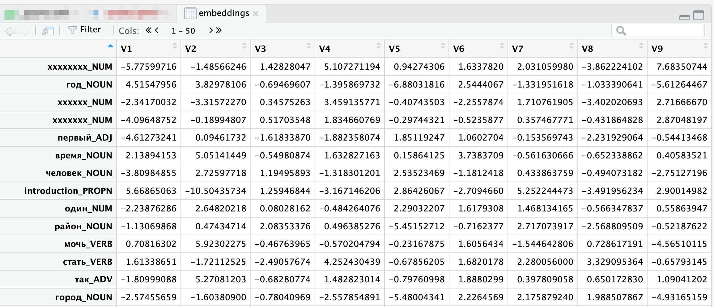

# Векторные представления слов

## Векторы в лингвистике 

Векторные представления слов - это совокупность подходов к моделированию языка, которые позволяют осуществлять _семантический_ анализ слов и составленных из них документов. Например, находить синонимы и квазисинонимы, а также анализировать значения слов в диахронной перспективе. 

В математике вектор -- это объект, у которого есть длина и направление, заданные координатами вектора. Мы можем изобразить вектор в двумерном или трехмерном пространстве, где таких координат две или три (по числу измерений), но это не значит, что не может быть 100- или даже 1000-мерного вектора: математически это вполне возможно. Обычно, когда говорят о векторах слов, имеют в виду именно многомерное пространство. 

Что в таком случае соответствует измерениям и координатам? Есть [несколько возможных решений](https://web.stanford.edu/~jurafsky/li15/lec3.vector.pdf). 

Мы можем, например, создать _матрицу термин-документ_, где каждое слово "описывается" вектором его встречаемости в различных документах (разделах, параграфах...). Слова  считаются похожими, если "похожи" их векторы (о том, как сравнивать векторы, мы скажем чуть дальше). Аналогично можно сравнивать и сами документы.

Второй подход -- зафиксировать совместную встречаемость (или другую меру ассоциации) между словами. В таком случае мы строим _матрицу термин-термин_. За контекст в таком случае часто принимается произвольное контекстное окно, а не целый документ. Небольшое контекстное окно (на уровне реплики) скорее сохранит больше _синтаксической_ информации. Более широкое окно позволяет скорее судить о _семантике_: в таком случае мы скорее заинтересованы в словах, которые имеют похожих соседей. 

И матрица термин-документ, и матрица термин-термин на реальных данных будут длинными и сильно разреженными (sparse), т.е. большая часть значений в них будет равна 0. С точки зрения вычислений это не представляет большой трудности, но может служить источником "шума", поэтому в обработке естественного языка вместо них часто используют так называемые плотные (dense) векторы, или _эмбеддинги_. Для этого к исходной матрице применяются различные методы снижения размерности. 

Подробнее о векторных моделях можено почитать [статью](https://sysblok.ru/knowhow/word2vec-pokazhi-mne-svoj-kontekst-i-ja-skazhu-kto-ty/) В. Селеверстова на "Системном блоке", а также посмотреть [видео](https://youtu.be/1ng7vHBo9bY?si=H9BFpG1MQNt-ije-) с лекцией Д. Рыжовой.

В этом уроке мы изучим несколько способов пострения эмбеддингов: 

- на основе совместной встречаемости слов с [использованием PMI](https://smltar.com/embeddings);
- с использованием поверхностной нейросети Word2Vec;
- c использованием трансформера BERT.

Также мы поговорим об использовании готовых (предобученных) эмбеддингов для разных языков.

```{r message=FALSE, warning=FALSE}
library(tidyverse)
library(tidytext)
library(stopwords)
library(widyr)
library(uwot)
library(word2vec)
library(text)
```

## Подготовка данных

Мы воспользуемся [датасетом](https://www.kaggle.com/datasets/marialevchenko/news-dataset-from-lenta-ru-2019-2023/data) с подборкой новостей на русском языке (для ускорения вычислений возьмем из него лишь один год). Файл в формате `.Rdata` в формате `.Rdata`  доступен по [ссылке](https://github.com/locusclassicus/text_analysis/raw/main/data/news.Rdata).


<details>
  <summary>Код для приведения датасета к опрятному виду.</summary>
  <p>
  
```{r}
load("../data/news.Rdata")

news_2019 <- news_2019 |> 
  mutate(id = paste0("doc", row_number()))
```

Составим список стоп-слов.

```{r eval=FALSE}
stopwords_ru <- c(
  stopwords("ru", source = "snowball"),
  stopwords("ru", source = "marimo"),
  stopwords("ru", source = "nltk"), 
  stopwords("ru", source  = "stopwords-iso")
  )

stopwords_ru <- sort(unique(stopwords_ru))
length(stopwords_ru)
```

Разделим статьи на слова и удалим стоп-слова; это может занять несколько минут.

```{r eval=FALSE}
news_tokens <- news_2019 |> 
  unnest_tokens(token, text) |> 
  filter(!token %in% stopwords_ru)
```

Многие слова встречаются всего несколько раз и для тематического моделирования бесполезны. Поэтому можно от них избавиться.

```{r eval=FALSE}
news_tokens_pruned <- news_tokens |> 
  add_count(token) |> 
  filter(n > 10) |> 
  select(-n)
```

Также избавимся от цифр, хотя стоит иметь в виду, что их пристутствие в тексте может быть индикатором темы: в некоторых случах лучше не удалять цифры, а, например, заменять их на некую последовательность символов вроде `digit` и т.п. Токены на латинице тоже удаляем.

```{r eval=FALSE}
news_tokens_pruned <- news_tokens_pruned |> 
  filter(str_detect(token, "[\u0400-\u04FF]")) |> 
  filter(!str_detect(token, "\\d"))
```

```{r eval=FALSE}
news_tokens_pruned
```

Этап подготовки данных -- самый трудоемкий и не самый творческий, но не стоит им пренебрегать, потому что от этой работы напрямую зависит качество модели. 

```{r echo=FALSE, eval=FALSE}
save(news_tokens_pruned, file = "../data/news_tokens_pruned.Rdata")
```

 </p>
</details>

Подготовленные данные можно забрать по [ссылке](https://github.com/locusclassicus/text_analysis/raw/refs/heads/main/data/news_tokens_pruned.Rdata).

```{r}
load("../data/news_tokens_pruned.Rdata")
```


## PMI-SVD эмбеддинги

### Скользящее окно

Прежде всего разделим  новости на контекстные окна фиксированной величины. Чем меньше окно, тем больше синтаксической информации оно хранит. 

```{r}
nested_news <- news_tokens_pruned |> 
  dplyr::select(-topic) |> 
  nest(tokens = c(token))

nested_news
```

```{r}
slide_windows <- function(tbl, window_size) {
  skipgrams <- slider::slide(
    tbl, 
    ~.x, 
    .after = window_size - 1, 
    .step = 1, 
    .complete = TRUE
  )
  
  safe_mutate <- safely(mutate)
  
  out <- map2(skipgrams,
              1:length(skipgrams),
              ~ safe_mutate(.x, window_id = .y))
  
  out  |> 
    transpose()  |> 
    pluck("result")  |> 
    compact()  |> 
    bind_rows()
}
```

Деление на окна может потребовать нескольких минут. Чем больше окно, тем больше потребуется времени и тем больше будет размер таблицы.

```{r eval=FALSE}
news_windows <- nested_news |> 
  mutate(tokens = map(tokens, slide_windows, 8L))  |>  
  unnest(tokens) |> 
  unite(window_id, id, window_id)

news_windows
```


```{r echo=FALSE, eval=FALSE}
save(news_windows, file = "../data/news_windows.Rdata")
```


```{r echo=FALSE}
load("../data/news_windows.Rdata")
```

### Что такое PMI 

Обычная мера ассоциации между словами, которой пользуются лингвисты, — точечная взаимная информация, или PMI (pointwise mutual information). Она рассчитывается по формуле:

$$PMI\left(x;y\right)=\log{\frac{P\left(x,y\right)}{P\left(x\right)P\left(y\right)}}$$

В числителе — вероятность встретить два слова вместе (например, в пределах одного документа или одного «окна» длинной n слов). В знаменателе — произведение вероятностей встретить каждое из слов отдельно. Если слова чаще встречаются вместе, логарифм будет положительным; если по отдельности — отрицательным. 

Посчитаем PMI на наших данных, воспользовавшись подходящей функцией из пакета `{widyr}`.

```{r}
news_pmi  <- news_windows  |> 
  pairwise_pmi(token, window_id)

news_pmi |> 
  arrange(-abs(pmi))
```

### Почему PPMI 

В отличие от коэффициента корреляции, PMI может варьироваться от $-\infty$ до $+\infty$, но негативные значения проблематичны. Они означают, что вероятность встретить эти два слова вместе _меньше_, чем мы бы ожидали в результате случайного совпадения. Проверить это без огромного корпуса [невозможно](https://web.stanford.edu/~jurafsky/li15/lec3.vector.pdf): если у нас есть $w_1$ и $w_2$, каждое из которых встречается с вероятностью $10^{-6}$, то трудно удостовериться в том, что $p(w_1, w_2)$ значимо отличается от $10^{-12}$.
Поэтому негативные значения PMI принято заменять нулями. В таком случае формула выглядит так:

$$ PPMI\left(x;y\right)=max(\log{\frac{P\left(x,y\right)}{P\left(x\right)P\left(y\right)}},0) $$
Для подобной замены подойдет векторизованное условие.

```{r}
news_ppmi <- news_pmi |> 
  mutate(ppmi = case_when(pmi < 0 ~ 0, 
                          .default = pmi)) 

news_ppmi |> 
  arrange(pmi)
```


### SVD

Для любых текстовых данных и матрица термин-термин будет очень разряженной (то есть большая часть значений будет равна нулю). Необходимо "переупорядочить" ее так, чтобы сгруппировать слова и документы по темам и избавиться от малоинформативных тем.

](https://sysblok.ru/wp-content/uploads/2019/07/image16.gif)

Для этого используется алгебраическая процедура под названием сингулярное разложение матрицы (SVD). При сингулярном разложении исходная матрица $A_r$ проецируется в пространство меньшей размерности, так что получается новая матрица $A_k$, которая представляет собой малоранговую аппроксимацию исходной матрицы [@маннинг2020, 407]. 

Для получения новой матрицы применяется следующая процедура. Сначала для матрицы $A_r$ строится ее сингулярное разложение (Singular Value Decomposition) по формуле: $A = UΣV^t$ . Иными словами, одна матрица представляется в виде произведения трех других, из которых средняя - диагональная. 


Здесь `U` — матрица левых сингулярных векторов матрицы `A`; `Σ` — диагональная матрица сингулярных чисел матрицы `A`; `V` — матрица правых сингулярных векторов матрицы `A`. О сингулярных векторах можно думать  как о топиках-измерениях, которые задают пространство для наших документов. 

Строки матрицы `U` соответствуют словам, при этом каждая строка состоит из элементов разных сингулярных векторов (на иллюстрации они показаны разными оттенками). Аналогично в `V^t` столбцы соответствуют отдельным документам. Следовательно, кажда строка матрицы `U` показывает, как связаны слова с топиками, а столбцы `V^T` -- как связаны топики и документы.

Некоторые векторы соответствуют небольшим сингулярным значениям (они хранятся в диагональной матрице) и потому хранят мало информации, поэтому на следующем этапе их отсекают. Для этого наименьшие значения в диагональной матрице заменяются нулями. Такое SVD называется _усеченным_. Сколько топиков оставить при усечении, решает человек. 

Собственно _эмбеддингами_, или векторными представлениями слова, называют произведения каждой из строк матрицы `U` на `Σ`, а эмбеддингами документа -- произведение столбцов `V^t` на `Σ`. Таким образом мы как бы "вкладываем" (англ. embed) слова и документы в единое семантическое пространство, число измерений которого будет равно числу сингулярных векторов. 

Передадим подготовленные данные фунции `widely_svd()`  для вычисления сингулярного разложения. Число измерений для усеченного SVD задается вручную. Обратите внимание на аргумент `weight_d`: если задать ему значение `FALSE`, то вернутся не эмбеддинги, а матрица левых сингулярных векторов:

```{r}
set.seed(123)
word_emb <- news_ppmi |> 
  widely_svd(item1, item2, ppmi,
             weight_d = FALSE, nv = 100) 
```

```{r}
word_emb
```

### Визуализация топиков

Визуализируем главные компоненты нашего векторного пространства. 

```{r}
word_emb |> 
  filter(dimension < 10) |> 
  group_by(dimension) |> 
  top_n(10, abs(value)) |> 
  ungroup() |> 
  ggplot(aes(reorder_within(item1, value, dimension), value, fill = dimension)) +
  geom_col(alpha = 0.8, show.legend = FALSE) +
  facet_wrap(~dimension, scales = "free_y", ncol = 3) +
  scale_x_reordered() +
  coord_flip() +
  labs(
    x = NULL, 
    y = "Value",
    title = "Первые 9 главных компонент за 2019 г.",
    subtitle = "Топ-10 слов"
  ) +
  scale_fill_viridis_c()
```

### Ближайшие соседи

Исследуем наши эмбеддинги, используя функцию, которая считает косинусное сходство между словами. 


```{r}
nearest_neighbors <- function(df, token) {
  df %>%
    widely(
      ~ {
        y <- .[rep(token, nrow(.)), ]
        res <- rowSums(. * y) / 
          (sqrt(rowSums(. ^ 2)) * sqrt(sum(.[token, ] ^ 2)))
        
        matrix(res, ncol = 1, dimnames = list(x = names(res)))
      },
      sort = TRUE
    )(item1, dimension, value) %>%
    select(-item2)
}
```


```{r}
word_emb |> 
  nearest_neighbors("сборная")

word_emb |> 
  nearest_neighbors("завод")
```


### 2D-визуализации пространства слов

```{r}
word_emb_mx <- word_emb  |> 
  cast_sparse(item1, dimension, value) |> 
  as.matrix()
```

Для снижения размерности мы используем алгоритм UMAP. Это алгоритм нелинейного снижения размерности.

```{r eval=FALSE}
set.seed(02062024)
viz <- umap(word_emb_mx,  n_neighbors = 15, n_threads = 2)
```

```{r echo=FALSE, eval=FALSE}
save(viz, file = "../data/viz.Rdata")
```

```{r echo=FALSE}
load("../data/viz.Rdata")
```

Как видно по размерности матрицы, все слова вложены теперь в двумерное пространство.

```{r}
dim(viz)
```

:::{.column-page}

```{r fig.width=12}
tibble(word = rownames(word_emb_mx), 
       V1 = viz[, 1], 
       V2 = viz[, 2]) |> 
  ggplot(aes(x = V1, y = V2, label = word)) + 
  geom_text(size = 2, alpha = 0.4, position = position_jitter(width = 0.5, height = 0.5)) +
   annotate(geom = "rect", ymin = -2, ymax = 1, xmin = 8, xmax = 11, alpha = 0.2, color = "tomato")+
  theme_light()
```

:::

Посмотрим на выделенный фрагмент этой карты. 

```{r fig.width=9}
tibble(word = rownames(word_emb_mx), 
       V1 = viz[, 1], 
       V2 = viz[, 2]) |> 
  filter(V1 > 8 & V1 < 11) |> 
  filter(V2 > -2 & V2 < 1) |> 
  ggplot(aes(x = V1, y = V2, label = word)) + 
  geom_text(size = 5, alpha = 0.5, 
            position = position_jitter(width = 0.5, height = 0.5)
            ) +
  theme_light()
```

Отличная работа 🥊 Теперь попробуем построить векторное пространство с использованием поверхностных нейросетей. 

## Word2Vec

[Word2vec](http://arxiv.org/pdf/1310.4546) -- это полносвязаная нейросеть с одним скрытым слоем. Такое обучение называется не глубоким, а поверхностным (shallow).

```{r word2vec}
corpus_w2v <- news_tokens_pruned |> 
  group_by(id) |> 
  mutate(text = str_c(token, collapse = " ")) |> 
  distinct(id, text)
```

```{r eval=!file.exists("../data/news_word2vec.bin")}
# устанавливаем зерно, т.к. начальные веса устанавливаются произвольно
set.seed(02062024) 
model <- word2vec(x = corpus_w2v$text, 
                  type = "skip-gram",
                  dim = 100,
                  window = 10,
                  iter = 20,
                  hs = TRUE,
                  min_count = 5,
                  threads = 1) # при нескольких потоках результат не воспроизводится

```

```{r echo=FALSE, eval=!file.exists("../data/news_word2vec.bin")}
# модель обучается при сборке только один раз, потом загружается из файла
write.word2vec(model, file = "../data/news_word2vec.bin")
```

```{r echo=FALSE}
model <- read.word2vec("../data/news_word2vec.bin")
```

Наша модель содержит эмбеддинги для слов; посмотрим на матрицу.

```{r}
emb <- as.matrix(model)
dim(emb)
```

```{r}
predict(model, c("погода", "спорт"), type = "nearest", top_n = 10) |> 
  bind_rows()
```

Получившуюся модель можно визуализировать, как мы это делали выше.


## BERT

BERT (Bidirectional Encoder Representations from Transformers) — это глубокая нейронная модель для обработки естественного языка, представленная Google в 2018 году. Главная особенность BERT — двунаправленное (bidirectional) чтение текста, позволяющее учитывать контекст слова как слева, так и справа. BERT обучается на задаче восстановления пропущенных слов в предложении и на предсказании, идут ли два предложения подряд.

Варианты BERT:

- BERT-base (12 слоев), BERT-large (24 слоя) — оригинальные модели разного размера.
- DistilBERT (6 слоев) — облегчённая и быстрая версия.
- RoBERTa, ALBERT, TinyBERT и др. — различные модификации BERT, оптимизированные для конкретных задач.
- Multilingual BERT (mBERT) — для многих языков сразу.


BERT генерирует контекстные эмбеддинги — числовые векторы, которые учитывают значение слова в конкретном контексте предложения. Благодаря этому BERT-эмбеддинги позволяют машинам лучше понимать смысл текста и эффективно применять их для поиска, классификации, вопросов-ответов и других NLP-задач. 

Для большинства задач на русском языке (эмбеддинги, классификация, поиск) лучше использовать одну из RuBERT (или RuRoBERT) моделей, они дают лучшие результаты, чем англоязычные или многоязычные варианты. 

### Reticulate

Для работы с трансформерами понадобится Python. Создадим виртуальное окружение, которое нужно для корректной работы с пакетом `{text}`.  


```{r eval=FALSE}
library(reticulate)
use_python("/usr/bin/python3")
```

```{r eval=FALSE}
py_config()
# python:         /usr/bin/python3
# libpython:      /Library/Developer/CommandLineTools/Library/Frameworks/Python3.framework/Versions/3.9/lib/python3.9/config-3.9-darwin/libpython3.9.dylib
# pythonhome:     /Library/Developer/CommandLineTools/Library/Frameworks/Python3.framework/Versions/3.9:/Library/Developer/CommandLineTools/Library/Frameworks/Python3.framework/Versions/3.9
# version:        3.9.6 (default, Feb  3 2024, 15:58:27)  [Clang 15.0.0 (clang-1500.3.9.4)]
# numpy:          /Users/olga/Library/Python/3.9/lib/python/site-packages/numpy
# numpy_version:  1.23.0
# 
# NOTE: Python version was forced by use_python() function
```


```{r eval=FALSE}
py_eval("1+1")
```

Для работы понадобятся модули `nltk` и `transformers`. Проверьте в терминале, установлены ли они, и, если надо, установите. 

```{r eval=FALSE}
# проверить 
/usr/bin/python3 -c "import nltk; print('nltk version:', nltk.__version__)"
/usr/bin/python3 -c "import transformers; print('transformers version:', transformers.__version__)"
# установить
/usr/bin/python3 -m pip install nltk transformers
```

Скачайте необходимые данные для NLTK.

```{r eval=FALSE}
py_run_string("
import nltk
nltk.download('punkt')
nltk.download('punkt_tab')
nltk.download('stopwords')
nltk.download('wordnet')
nltk.download('omw-1.4')
")
```


###  Эмбеддинги

Получаем эмбеддинги с помощью `textEmbed()`. Это долго (для нашего датасета около двух часов). Для пробы берем лишь несколько новостей. 

```{r}
set.seed(18112025)
news_sample <- news_2019 |> 
  filter(topic %in% c("Экономика", "Культура", "Спорт")) |> 
  sample_n(size = 25)
```

Во время обучения вы увидите предупреждение о non-ASCII символах. Если ваша модель обучена на русском или многоязычная, это предупреждение можно игнорировать. 

```{r eval=FALSE}
emb <- textEmbed(
  texts = news_sample$text,
  # или другая модель
  model = "cointegrated/rubert-tiny2",  
  # по умолчанию 
  layers = -2,     
  remove_non_ascii = FALSE
)
```

```{r echo=FALSE, eval=FALSE}
save(emb, file = "../data/emb_bert.Rdata")
```

```{r echo=FALSE}
load("../data/emb_bert.Rdata")
```

Получаем эмбеддинги для токенов. 313 - размерность эмбеддинга для каждого токена.  BERT-токенизатор использует WordPiece токенизацию, которая разбивает слова на субтокены. Это позволяет обрабатывать редкие и неизвестные слова.

```{r}
emb$tokens$texts[[2]] 
```

Токен [CLS] (=classification) — это специальный служебный токен BERT (и его производных моделей), который автоматически добавляется в самое начало каждого входного текста.

```{r}
emb$texts$texts
```

### 2D-визуализации


```{r}
emb_texts <- emb$texts$texts  |> 
  mutate(text_id = news_sample$id) |> 
  mutate(topic = news_sample$topic)

umap_res <- emb_texts |> 
  dplyr::select(-text_id, -topic) |> 
  as.matrix() |> 
  umap(n_neighbors = 15, min_dist = 0.1, metric = "cosine")

plot_df <- as.data.frame(umap_res) |> 
  setNames(c("UMAP1", "UMAP2")) |> 
  mutate(text_id = emb_texts$text_id, 
         topic = emb_texts$topic)

plot_df |> 
  ggplot(aes(UMAP1, UMAP2, color = topic)) +
  geom_text(aes(label = text_id), alpha = 0.8, size = 3) +
  theme_minimal()
```

Doc2672 содержит новость о дочери актера, а doc519 -- о рейтинге самых высокооплачиваемых иллюзионистов.

### Ближайшие соседи

```{r}
nearest_neighbors_matrix <- function(df, feat_row) {
  # df: датафрейм или матрица, в каждой строке эмбеддинг
  # feat_row: индекс строки/имя строки, для которой ищем соседа
  m <- as.matrix(df)
  
  # вектор-эмбеддинг выбранного текста
  v <- m[feat_row, ]
  
  # косинусное сходство
  similarities <- (m %*% v) / (sqrt(rowSums(m^2)) * sqrt(sum(v^2)))
  
  # самого себя не берём
  similarities[feat_row] <- -Inf
  
  # ближайший – максимальное сходство
  nn_idx <- which.max(similarities)
  
  # выводим результат
  list(
    index = nn_idx,
    similarity = similarities[nn_idx]
  )
}
```

```{r}
nn <- nearest_neighbors_matrix(df = emb_texts %>% dplyr::select(-text_id, -topic), feat_row = 5)

nn
```

```{r}
news_sample |> 
  filter(row_number() == 5) |> 
  pull(text)
```
```{r}
news_sample |> 
  filter(row_number() == nn$index) |> 
  pull(text)
```

## Предобученные эмбеддинги

Преобученные эмбеддинги можно скачать [отсюда](https://fasttext.cc/docs/en/crawl-vectors.html) или (только для русского) [отсюда](https://rusvectores.org/ru/models/). Компактные модели для русского также можно найти [здесь](https://github.com/natasha/navec).

### Что учитывать при выборе модели 


1. КОНТЕКСТУАЛИЗИРОВАННЫЕ vs. СТАТИЧЕСКИЕ МОДЕЛИ. 

  - В _статических_ моделях типа Word2Vec или GloVe каждое слово имеет только один фиксированный вектор (например, слово "замок" — один и тот же вектор, независимо от значения: "castle" или "lock"). Они легче и быстрее в использовании, требуют меньше ресурсов, чаще всего доступны в виде простых таблиц: слово — вектор. 
  - В _контекстуализированных_ моделях типа BERT одно и то же слово имеет РАЗНЫЕ вектора в зависимости от окружения ("контекста"). Они применимы для анализа значения в конкретном предложении, больше по размеру, нужны скрипты/программы для генерации эмбеддингов, иногда требуют GPU. Обычно их используют для представления предложений или текстов целиком, а не отдельных слов.

2. КОРПУС — из какого текстового источника училась модель. 

  - НКРЯ: Национальный корпус русского языка — самый сбалансированный и научный.
  - Википедия: Энциклопедическая, больше терминов, меньше разговорных выражений.
  - Новости: Хороша для современных новостных тем, немного односторонний стиль.
  - Araneum, Тайга, GeoWAC, Веб: Огромные веб-корпусы — больше сленга, просторечий, шире охват, но меньше структурированности (могут быть ошибки, дубли, шум).

3. ПРЕДОБРАБОТКА — как были подготовлены тексты.
  - Лемматизация (все слова приведены к начальной форме) или токенизация.
  - Разметка (PoS): Теги частей речи ("делать_VERB").

4. РЕЖИМ ОБУЧЕНИЯ: CBOW vs. SKIPGRAM

  - CBOW: Предсказывает слово по его контексту (соседним словам). Пример: контекст — "Я ___ в кино". 
  - Skip-gram: Делает наоборот — по слову предсказывает окружающие его слова. Пример: "иду" → ["Я", "в", "кино"]
 
 


Для большинства задач рекомендуется выбирать предобученные модели, обученные с помощью Skip-gram, поскольку они лучше работают с редкими словами и устойчивыми выражениями, что особенно важно для русского языка с его богатой морфологией; CBOW можно использовать, если нужен более быстрый расчет и основное внимание уделяется массовым (частотным) словам, однако качество представлений на редких и сложных словах у Skip-gram почти всегда выше, поэтому если вы не ограничены во времени и ресурсах — отдавайте предпочтение именно ей.

### Операции с эмбеддингами 

Модель `ruwikiruscorpora_upos_cbow_300_10_2021` весит 638 Мб при скачивании.

```{r eval=FALSE}
vec_path <- "../files/220/model.bin"

embeddings <- word2vec::read.wordvectors(vec_path, type = "bin")
```


```{r eval=FALSE}
dim(embeddings)
```


```{r eval=FALSE}
# Создаем свою функцию косинусного сходства
cosine_similarity <- function(x, y) {
  sum(x * y) / (sqrt(sum(x^2)) * sqrt(sum(y^2)))
}

# Матричная версия для многих векторов
cosine_similarity_matrix <- function(x, y) {
  x_norm <- x / sqrt(rowSums(x^2))
  y_norm <- y / sqrt(rowSums(y^2))
  tcrossprod(x_norm, y_norm)
}

find_similar <- function(word, embeddings, top_n = 10) {
  if (!word %in% rownames(embeddings)) {
    return(paste("Слово", word, "не найдено в словаре"))
  }
  
  word_vec <- matrix(embeddings[word, ], nrow = 1)
  
  # Считаем косинусное сходство со всеми словами
  similarities <- apply(embeddings, 1, function(x) {
    cosine_similarity(word_vec[1, ], x)
  })
  
  # Сортируем по убыванию сходства
  sorted_indices <- order(similarities, decreasing = TRUE)
  similar_words <- names(similarities)[sorted_indices[2:(top_n + 1)]]  # пропускаем само слово
  similarity_scores <- similarities[sorted_indices[2:(top_n + 1)]]
  
  data.frame(word = similar_words, similarity = round(similarity_scores, 4))
}
```

```{r eval=FALSE}
# Использование
find_similar("время_NOUN", embeddings)
find_similar("человек_NOUN", embeddings)
```

## Видео

- [Видео](https://vkvideo.ru/video91786643_456239053) 2024 г.
- [Видео](https://vk.com/video91786643_456239090) 2025 г.

## Домашнее задание

- Примите ссылку на домашнее задание через Classroom <https://classroom.github.com/a/LZo22NPk>

- В репозитории вы найдете код и инструкцию по скачиванию данных.

- Вам надо осмыслить (!) код и ответить на практические и теоретические вопросы в Forms ([ссылка](https://forms.gle/3w2rJotTJsgbPwr27))

- Работа оценивается по шкале 0-10.

- Дедлайн для сдачи: 5 декабря 2025 г., 21-00.


